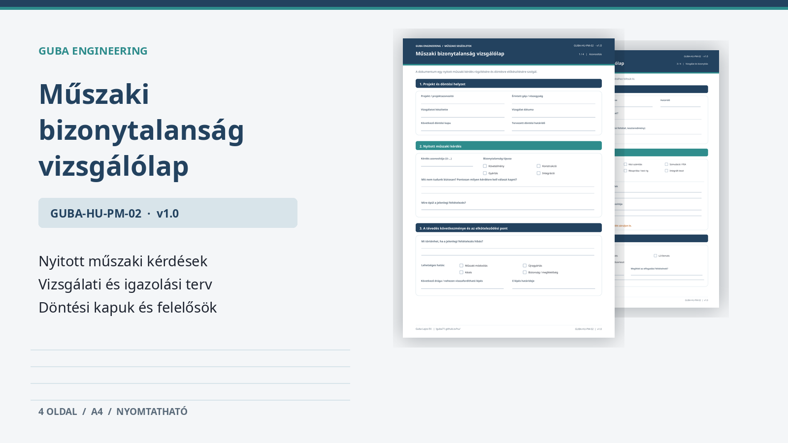

<section style="margin-bottom: 2rem;">

  

    Letölthető magyar műszaki segédletek, munkalapok és ellenőrzőlisták
    gyártástámogatási, gépésztervezési és dokumentációs témákhoz.
  

  

    Ezek az anyagok gyors döntéstámogatásra, előzetes felmérésre vagy belső műszaki
    egyeztetésre használhatók. Nem helyettesítik a részletes projekt-, költség- vagy
    minőségügyi elemzést, de segíthetnek az első lépések strukturálásában.
  

</section>

<section style="margin: 2rem 0;">

  <h2>Műszaki projektvezetés és döntéstámogatás</h2>

  

    

      GUBA-HU-PM-02 · PDF munkalap · v1.0
    

    <h3 style="margin-top: 0;">Műszaki bizonytalanság vizsgálólap</h3>

    

      Négyoldalas, kézzel kitölthető munkalap műszaki bizonytalanságok,
      feltételezések, vizsgálatok, bizonyítékok és továbbengedési döntések
      követéséhez célgép- és automatizálási projektekben.
    

    

      
    

    

      <a href="/hu/eszkozok/pdf/GUBA-HU-PM-02-muszaki-bizonytalansag-vizsgalolap.pdf">
        PDF letöltése
      </a>
      ·
      <a href="/hu/eszkozok/kepek/jegyzetek/GUBA-HU-PM-02-muszaki-bizonytalansag-vizsgalolap-elonezet.png">
        Négyoldalas előnézet
      </a>
      ·
      <a href="/hu/jegyzetek/muszaki-bizonytalansag-mikor-szabad-tovabblepni-egy-projektben/">
        Kapcsolódó cikk
      </a>
    

  

</section>

<section style="margin: 2rem 0;">

  <h2>Készülékek és gyártási segédeszközök</h2>

  

    

      GUBA-HU-FIX-01 · PDF munkalap · v1.0
    

    <h3 style="margin-top: 0;">Készülék megtérülési vizsgálólap</h3>

    

      Kézzel kitölthető, négyoldalas vizsgálólap egyszerű készülék, jig, fixture vagy
      befogó várható megtérülésének előzetes becsléséhez. A munkalap ciklusidő,
      ellenőrzési idő, átállási idő, selejt, utómunka és egyéb hatások alapján segít
      végiggondolni a döntést.
    

    

      <a href="/hu/eszkozok/pdf/GUBA-HU-FIX-01-keszulek-megterulesi-vizsgalolap.pdf">
        PDF letöltése
      </a>
    

  

</section>
